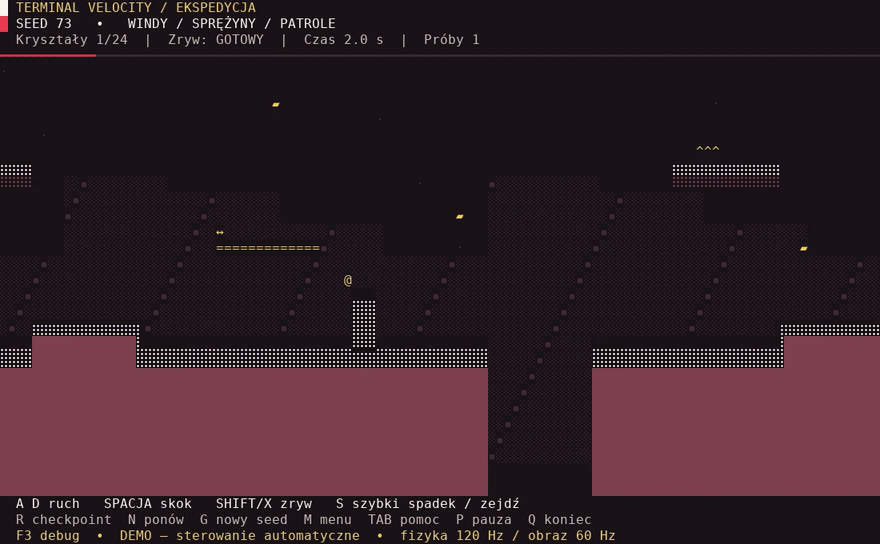
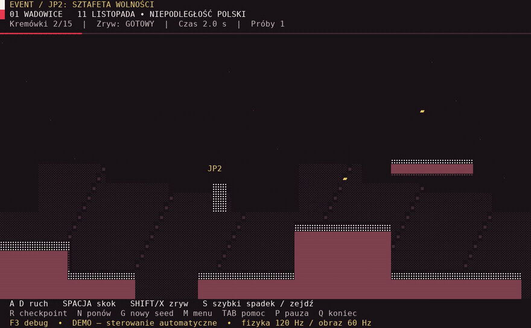
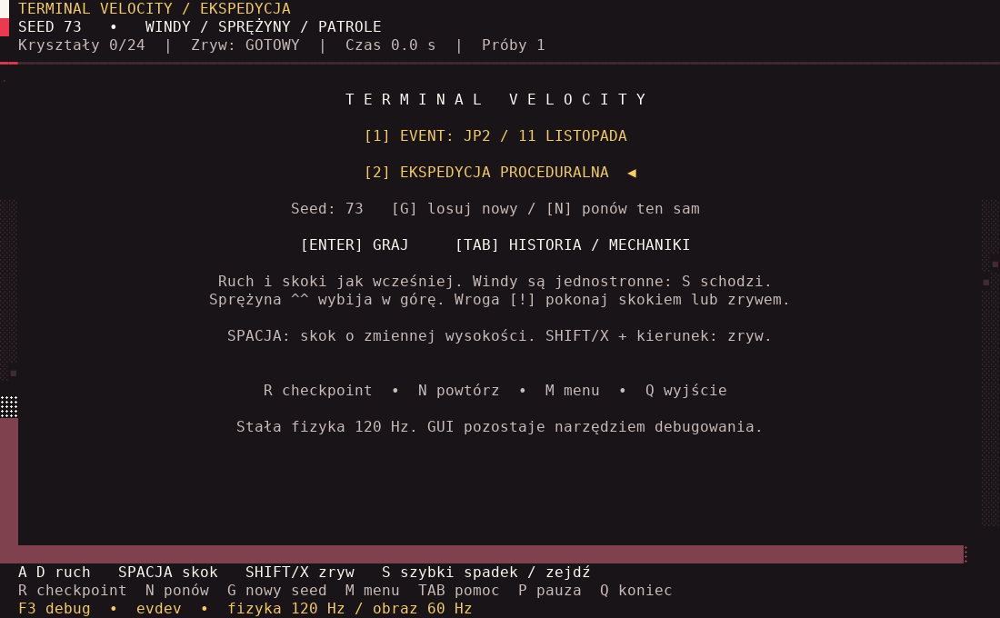
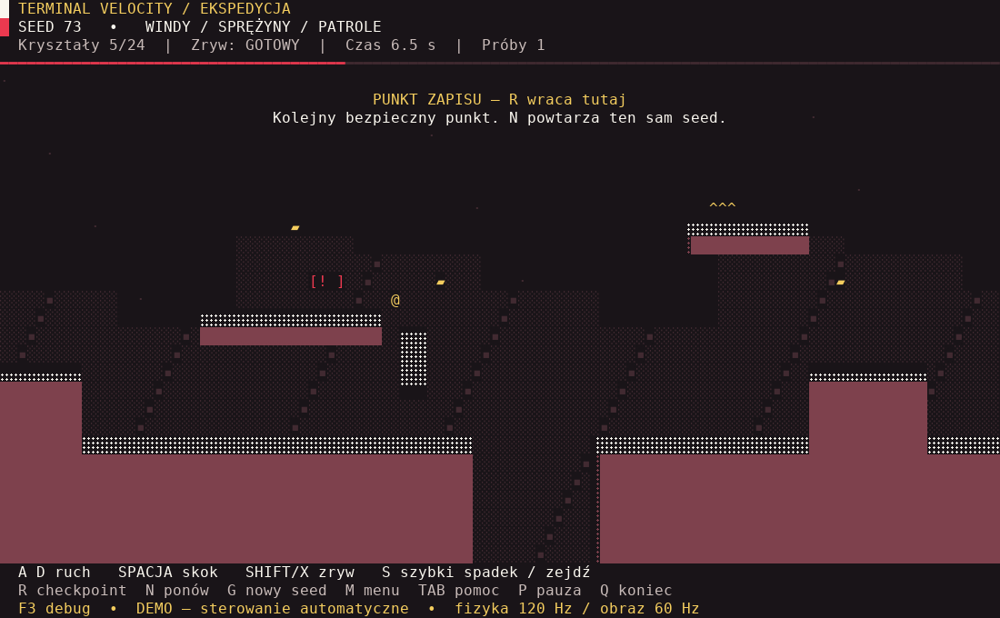
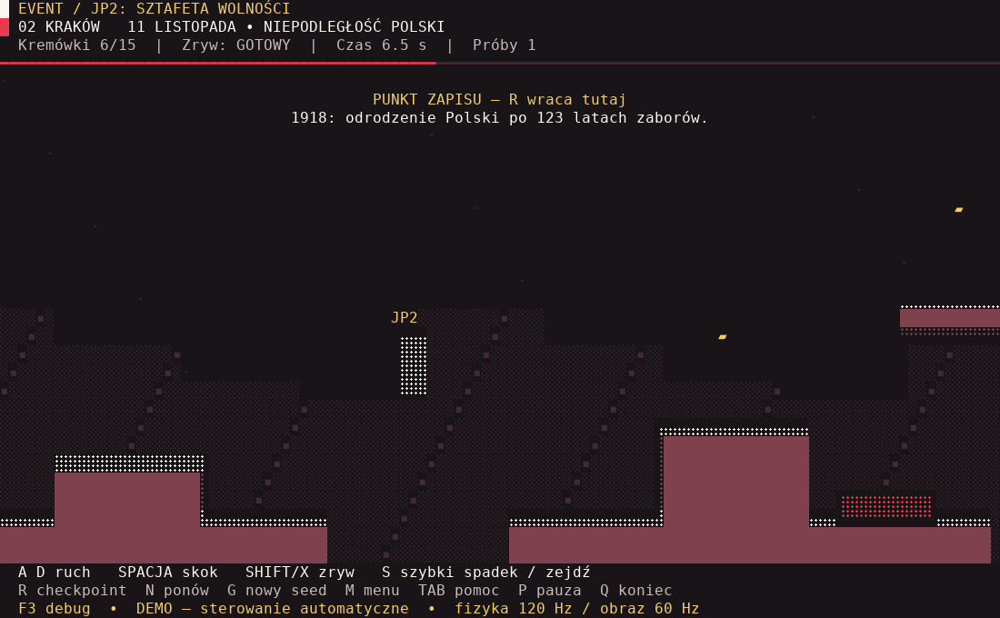

# Terminal Velocity

**A Ghostty-first platformer. Real keyboard input. Fixed 120 Hz physics.**

Run, jump, wall-jump and dash through seeded courses with moving platforms, springs and patrols. The original **JP2: Sztafeta Wolności** course lives on as a special Polish Independence Day event.

The terminal is the main game. The SDL window is a debug frontend for comparing the same physics and collisions.

[Polska instrukcja](README.pl.md) · [Controls](#controls) · [SSH mode](#play-over-ssh) · [Tests](#build-and-test)

## See it move

### Procedural expedition



[Watch the full MP4](docs/media/procedural.mp4) · [Download the terminal recording](docs/media/procedural.cast)

### JP2 / 11 Listopada event



[Watch the full MP4](docs/media/jp2-event.mp4) · [Download the terminal recording](docs/media/jp2-event.cast)

These are actual `--demo` runs recorded from a 110×34 PTY. GIFs, videos and screenshots render that captured terminal output with DejaVu Sans Mono and geometric Braille/block glyphs; they are not desktop recordings or mockups. The `.cast` files preserve the original output and timing. Reproduce the media with [`tools/record_showcase.py`](tools/record_showcase.py) (Python, pyte, Pillow and ffmpeg).

<details>
<summary>Full-size screenshots</summary>





</details>

## Play on Linux

On Arch / CachyOS:

```sh
sudo pacman -S --needed base-devel ghostty git
# Optional debug GUI dependencies:
sudo pacman -S --needed sdl2-compat freetype2

git clone https://github.com/aridlin/terminal-velocity.git
cd terminal-velocity
make terminal_velocity keyboard_launcher
./play.sh
```

Run `./play.sh` inside Ghostty, or `./ghostty-play.sh` to open a new Ghostty window. Use at least **76×24** cells; **110×34** is recommended.

To add the command to your own user bin directory:

```sh
mkdir -p ~/.local/bin
ln -s "$PWD/ghostty-play.sh" ~/.local/bin/terminal-velocity
```

Keep the clone in place: the launcher resolves its installation directory. Ensure `~/.local/bin` is on your PATH.

### Local input

The default input path reads **evdev key-down/key-up events**, outside the terminal input stream. Holding movement, jump and dash together does not depend on terminal autorepeat.

If your account cannot read the keyboard device, `play.sh` asks for sudo in the terminal. The small [`keyboard_launcher`](keyboard_launcher.cpp) opens keyboard descriptors, **permanently drops root**, and runs the game as your normal user. It does not install a setuid binary or change groups, ACLs or udev rules. Access ends with the game. Keystrokes are not logged. Losing terminal focus pauses play.

Prefer not to use that helper? `./play.sh --ssh` also works locally through the terminal keyboard protocol.

## Pick a run

| Key | Action |
| --- | --- |
| **1** | Original JP2 / 11 Listopada event |
| **2** | Procedural expedition |
| **Enter** | Start or resume |
| **N** | Retry the same level and seed |
| **G** | Generate the next seed |
| **M** | Return to the level menu |

```sh
./play.sh --seed 73    # Repeatable procedural course
./play.sh --event      # Original Independence Day course
```

Procedural courses combine eight bounded sections, safe checkpoint bays and optional upper routes. Seeded maps include:

- **Moving platforms:** ride them, jump through from below, or drop through with S.
- **Springs:** a higher launch and a fresh dash charge.
- **Patrols:** defeat them with a stomp or dash; touching their side resets to your checkpoint.
- **Crystals:** optional pickups that recharge dash. The event uses kremówki instead.

The same seed produces the same layout in this generator version. The tests complete 100 seeds using ordinary inputs without deaths; this is not an exhaustive proof across every possible seed.

## Controls

| Input | Action |
| --- | --- |
| A / D or arrows | Move |
| Space / W / up | Jump; hold higher, release for a short hop |
| Shift / X + direction | Eight-direction dash |
| S / down | Fast-fall; drop through moving platforms |
| Jump beside a wall | Wall-jump |
| R | Return to the checkpoint |
| Tab | Event history or mechanic guide |
| Esc / P | Pause |
| F3 | Diagnostics |
| Q | Quit |

Landing or collecting a new pickup refreshes dash. Death preserves collected items and defeated patrols within the current run. **N resets the run.**

The movement keeps coyote time, jump buffering, variable jump height, air braking and a protected wall-jump impulse. Simulation runs at **120 Hz**, independently of the terminal's **60 Hz** drawing.

## Play over SSH

Build the TUI on the remote Linux machine; no SDL, display server or root access is needed:

```sh
make terminal_velocity
./play.sh --ssh --seed 73
```

Or start it directly from your client:

```sh
ssh -tt user@host '/path/to/terminal-velocity/play.sh --ssh --seed 73'
```

The launcher detects `SSH_CONNECTION` / `SSH_TTY` and selects SSH input automatically. It **never reads the server's keyboard devices** in this mode.

- **Extended mode:** negotiates the kitty keyboard protocol for real press/release events, including simultaneous keys and sequences split across packets. Ghostty can supply these events through SSH.
- **Portable fallback:** `--ssh-basic` uses explicit direction selection: **A/D starts running, S stops, Space jumps, X dashes**. It needs neither key-release reporting nor autorepeat timing. The fallback uses horizontal dashes and a fixed jump-hold duration; leave platforms at their edges.

SSH draws at up to **30 Hz**, still simulating at 120 Hz and transmitting changed cells. Network latency still affects response. If a terminal multiplexer intercepts keyboard sequences, use a direct connection or `--ssh-basic`.

Both modes were exercised through an actual localhost OpenSSH connection and remote PTY, including clean restoration of terminal state on exit. See [test results](TEST-RESULTS.txt).

## Build and test

```sh
make                  # TUI, keyboard helper, and SDL debug frontend
make test             # Physics, seeded courses, mechanics, SSH parser, SDL smoke
./terminal_velocity --demo --seed 73
./terminal_velocity --demo --event
```

The TUI and helper need C++20 and standard Linux headers. The debug GUI additionally needs SDL2, FreeType and pkg-config. On Debian/Ubuntu, the corresponding build packages are `g++ make pkg-config libsdl2-dev libfreetype6-dev`.

Tests cover resting contacts, acceleration/braking, jump height, identical simulation at 30/60/144 Hz, short taps, normalized dash speed, collision tunnelling, coyote time, jump buffers, wall jumps, checkpoints, the original event route, moving-platform carry, drop-through, springs, patrol combat and 100 procedural seeds. SSH parser tests cover fragmented sequences, simultaneous keys, releases, short taps and focus changes.

### SDL: debugging only

```sh
./terminal_velocity_sdl --seed 73
./terminal_velocity_sdl --event
```

Both frontends share [`main.cpp`](main.cpp). In the GUI, F3 shows hitboxes and motion data, F11 toggles fullscreen, M toggles sound, and Ctrl+R resets the run. Select 1/2/G from its menu or pause screen. Its event-to-tick timer is not a hardware input-latency measurement.

## Design references and event sources

- [Celeste & Forgiveness — Maddy Makes Games](https://www.mattmakesgames.com/articles/celeste_and_forgiveness/index.html): forgiving timing windows, coyote time and jump buffering. Platform carry here is not Celeste's full lift-momentum system.
- [Spelunky — Mossmouth](https://spelunkyworld.com/whatis.html): randomized repeatable runs, optional routes and risk/reward. This game's generator is deliberately smaller and simpler.
- [Official kitty keyboard protocol](https://sw.kovidgoyal.net/kitty/keyboard-protocol/): PTY press/repeat/release reporting.

The JP2 event is playful fiction about Polish cultural memory. John Paul II is **not portrayed as a participant in the 1918 independence events**. The history journal draws on the [Sejm's Independence Day overview](https://www.sejm.gov.pl/sejm10.nsf/komunikat.xsp?documentId=DE27C0547C515309C1258D3B003FDE4F) and the [Vatican's John Paul II biography](https://www.vatican.va/content/john-paul-ii/en/biografia/documents/hf_jp-ii_spe_20190722_biografia.html).

Bundled font license: [`assets/FONT-LICENSE.txt`](assets/FONT-LICENSE.txt).
